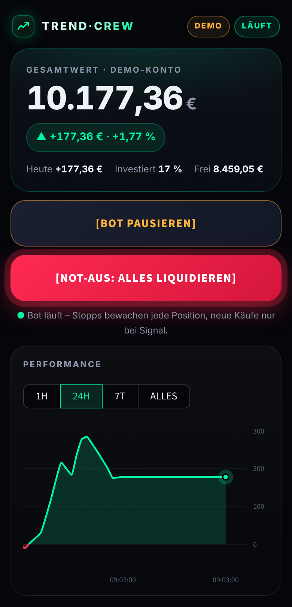
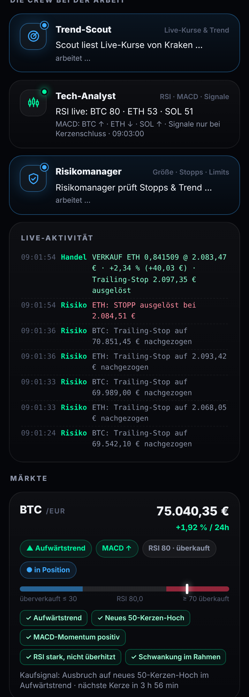
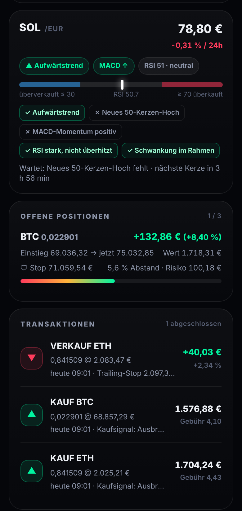

# TREND·CREW – Krypto-Handelsbot für BTC, ETH, SOL (nur Mathematik, keine KI-Kosten)

Ein eigenständiges Python-Projekt, das **rund um die Uhr** auf einem Cloud-Server läuft (Replit, Render, eigener Server) und
etablierte Kryptowährungen nach **festen mathematischen Regeln** handelt – ohne KI-API, ohne Abo, ohne laufende Zusatzkosten.
Das Handy-Dashboard (Streamlit, Dark-Mode, neon-grün/-rot) zeigt jederzeit, was die „Crew“ gerade tut.

| Übersicht · Steuerzentrale · Chart | Crew bei der Arbeit · Märkte | Positionen · Transaktionen |
|---|---|---|
|  |  |  |

> ⚠️ **Ehrlich vorab:** Kein Bot kann Gewinne garantieren. Im Backtest (5,8 Jahre echte Kurse) hat dieses System **nach Gebühren
> ein kleines Plus bei sehr geringem Verlustrisiko** erzielt – und die RSI-„Überverkauft-kaufen“-Idee hat **verloren** (Details unten).
> Starte immer im **Demo-Modus** (Spielgeld). Das ist keine Finanzberatung.

---

## 1. Schnellstart

**Auf Replit (empfohlen für Anfänger):** → **[ANLEITUNG_REPLIT.md](ANLEITUNG_REPLIT.md)** (Schritt für Schritt, mit Handy-Link).

**Lokal / eigener Server:**

```bash
pip install -r requirements.txt
python selftest.py          # prüft Börsen-Verbindung (keine Orders!)
python main.py              # startet Motor + Dashboard auf http://localhost:5000
```

Der Startmodus ist **Demo mit 10.000 € Spielgeld** – es braucht weder Konto noch API-Key (echte Live-Kurse von Kraken, öffentlich).

## 2. Der Schalter: Demo ↔ Live

Ganz oben in [`config.py`](config.py):

```python
PAPER_TRADING = True    # True  = DEMO mit Spielgeld (sicher, Standard)
                        # False = LIVE mit ECHTEM GELD über deine Börsen-API-Keys
```

* `True` → alles läuft mit simuliertem Spielgeld (echte Kurse, simulierte Ausführung inkl. 0,26 % Gebühr + Slippage).
* `False` → der Bot handelt über **deine** Börsen-API-Keys (Kraken/Binance) mit deinem **echten Guthaben**. Voraussetzungen (sonst bleibt Live gesperrt):
  `DASHBOARD_PASSWORD` gesetzt · `EXCHANGE_API_KEY` + `EXCHANGE_API_SECRET` gesetzt · `LIVE_CAPITAL` > 0 · API-Key **ohne Auszahlungsrecht**.

**Wohin fließt das Geld?** Dein Geld bleibt die ganze Zeit **auf deinem eigenen Börsenkonto**. Der Bot kauft/verkauft dort – Gewinne
landen automatisch wieder in deinem Guthaben dort, von wo du sie wie gewohnt aufs Bankkonto auszahlen kannst. Der Code enthält
**keine** Auszahlungs- oder Überweisungsfunktion; ein Key mit Auszahlungsrecht wird vom Bot sogar abgelehnt (wo die Börse es verrät).

## 3. Die Crew – drei Stufen, feste Regeln

Alle Regeln sind **reine Funktionen** ([`crew/strategy.py`](crew/strategy.py)); Live-Bot und Backtest benutzen exakt denselben Code.

| Stufe | Aufgabe | Regeln (Standard) |
|---|---|---|
| **1 · Trend-Scout** | Zieht Live-Kurse über **CCXT** (alle 5 s) und Kerzen (4 h + Tag). Bewertet das Marktregime. | Tages-**Aufwärtstrend** = Schlusskurs über EMA200 *und* EMA50 über EMA200 (Tageskerzen). Handelbar nur bei kleinem Spread (< 0,5 %), frischen Daten, normaler Schwankung. Bei mehreren Signalen bekommt der Coin mit der größten 30-Tage-Stärke zuerst Kapital. |
| **2 · Tech-Analyst** | Rechnet **RSI(14)** und **MACD(12,26,9)** auf *geschlossenen* 4h-Kerzen. | **Kauf**, wenn gleichzeitig: Aufwärtstrend ✓ · Kurs bricht auf ein **neues 50-Kerzen-Hoch** (≈ 8 Tage) ✓ · **MACD-Histogramm > 0** ✓ · **RSI zwischen 50 und 80** (stark, aber nicht überhitzt) ✓ · Schwankung im Rahmen ✓. Im Dashboard siehst du pro Coin, welche Haken fehlen. |
| **3 · Risikomanager** | Rechnet die **exakte Positionsgröße** und führt den **Trailing-Stop**. | Größe = (1 % vom Konto) ÷ (Abstand zum Stop + Gebühren) → ein Stopp kostet **ca. 1 % vom Konto**. Max. 30 % pro Coin, 80 % insgesamt, 3 Positionen. **Stop = höchster Kurs − 5 × ATR(14)**, wandert **nur nach oben**, wird alle 5 s geprüft. Abkühlphase nach Verlust (6 Kerzen). **Tagesverlust-Bremse** −3 %: keine Käufe mehr bis 00:00 UTC. **Notbremse** bei −15 % vom Höchststand: alles verkaufen, Bot stoppt. |

Zusätzlich gibt es den Modus `STRATEGY_MODE = "dip"` (RSI aus dem überverkauften Bereich + MACD dreht, im Tages-Aufwärtstrend) – so wie ursprünglich
gewünscht, aber **im Backtest nach Gebühren schwächer** (siehe unten), deshalb nicht Standard. Optionale Verkaufssignale (RSI-überhitzt + MACD-Abwärtsdreh,
Trendbruch) sind eingebaut, aber ausgeschaltet, weil sie im Test Gewinne zu früh abschnitten.

## 4. Ehrlicher Backtest (echte Kurse, mit Gebühren)

Reproduzierbar mit `python -m backtest.run` (lädt öffentliche Binance-Kurse BTC/ETH/SOL, 1. Januar 2021 → heute; Gebühr 0,26 % je Order + 0,05 % Slippage;
Signale nur auf geschlossenen Kerzen, Kauf zur nächsten Eröffnung, Stopp-Lücken füllen zum schlechteren Kurs; gleiche Risiko-Regeln wie live).

**Standard-Einstellungen** (4h-Kerzen, Ausbruch-Modus, 1 % Risiko, Stop 5×ATR), Startkapital 10.000, **11.01.2021 → 08.11.2026 (5,8 Jahre)**:

| | Bot | Kaufen & Halten (BTC/ETH/SOL gleich gewichtet) |
|---|---|---|
| Gesamtrendite | **+36,4 %** (≈ +5,5 % pro Jahr) | +1.030 % |
| Größter Rückgang (Max-Drawdown) | **−9,8 %** | **−95,1 %** |
| Trades | 138 · Gewinner-Quote 41 % · Profit-Faktor 1,66 | – |
| Ø Gewinn / Ø Verlust je Trade | +18,6 % / −6,0 % der Position | – |
| Gebühren gesamt | ≈ 1.025 | ≈ 50 |

| Jahr | 2021 | 2022 | 2023 | 2024 | 2025 | 2026 (bis Nov) |
|---|---|---|---|---|---|---|
| Bot | +25,6 % | **±0,0 %** (im Crash komplett in Cash) | +1,6 % | +7,4 % | +1,3 % | −1,8 % |

**Was das heißt – bitte ehrlich lesen:**

* Der Bot ist ein **Verlustbegrenzer**, kein Renditemaschine: Er verpasst Kurs-Manien (Kaufen & Halten war hier astronomisch besser – bei zwischenzeitlich **−95 %**), sitzt aber Crashs
  (2022) in Cash aus. Wer 1.000 % Rendite *und* −95 % Rückgang erträgt, braucht diesen Bot nicht; wer Verluste begrenzen will, schon.
* **Die ursprüngliche Idee „RSI überverkauft → kaufen“ hat verloren** (`--mode dip`: +9,4 %, Profit-Faktor 1,23, Notbremse 2023 ausgelöst; mit engen Stopps klar negativ).
  Kryptokurse fallen in Abwärtsphasen oft viel weiter, als der RSI „überverkauft“ meldet; Gebühren (0,52 % pro Kauf+Verkauf) fressen die kleinen Gewinne.
  Was funktionierte: **Trend + Ausbruch + weiter Trailing-Stop**, RSI/MACD als Bestätigung. 1h-Kerzen waren wegen der Gebühren schlechter (z. B. `--timeframe 1h --stop-mult 8`: +5,7 %, −15 % Rückgang).
* **Der Test ist optimistisch.** Ich habe ca. 50 Varianten auf *denselben* Daten verglichen und die robusteste gewählt (Ergebnis in beiden Hälften 2021–2023 und 2024–2026 positiv, aber 2024–2026 nur
  noch **+2 bis +7 %**). Echte Ergebnisse sind wahrscheinlich schlechter (Slippage, Börsenausfälle, ein anderes Marktumfeld).
* Mehr Risiko je Trade (`RISK_PER_TRADE_PCT=2` oder 3) erhöht Rendite *und* Rückgang – im Test löste dann die Notbremse (−15 %) aus und stoppte den Bot dauerhaft. Das ist gewollt: so verhält er sich auch live.
* Der Bot handelt **selten** (im Schnitt ~2 Trades pro Monat über alle Coins). Wochenlang „nichts passiert“ ist normal.

## 5. Sicherheit im Live-Betrieb (was der Code garantiert)

* **Nur eigene Positionen:** Der Bot verwaltet ein eigenes Buch. Andere Coins auf deinem Konto fasst er nie an, verkauft höchstens, was er selbst gekauft hat (und nie mehr, als wirklich da ist).
* **Budget-Deckel:** höchstens `LIVE_CAPITAL` (auch wenn mehr auf dem Konto liegt); harte Obergrenze je Order; Mindestgrößen/Rundung der Börse werden eingehalten (Menge wird abgerundet).
* **Keine Auszahlungen:** keine Funktion dafür im Code; Keys mit Auszahlungsrecht werden (soweit prüfbar) abgelehnt. Du erzeugst den Key ohne dieses Recht.
* **Unklare Orders werden nie blind wiederholt:** Bei Timeout sucht der Bot die Order über Client-ID/Orderliste; findet er sie nicht, bleibt der Ausgang „unklar“ und wird mit dem Guthaben abgeglichen (Verdopplungsschutz).
* **Stopps laufen immer** – auch im Zustand „pausiert“, nach einem Neustart und nach Verbindungsabbrüchen (sobald Kurse wieder da sind). Der Zustand wird nach jeder Änderung gespeichert (Datei oder Postgres).
* **Notbremsen:** Tagesverlust-Limit, Drawdown-Limit, NOT-AUS-Knopf (mit Sicherheitsabfrage), Kursdaten-Plausibilitätsprüfung (einzelne Ausreißer-Kurse lösen keinen Stopp aus).
* **Passwortschutz:** Live ohne `DASHBOARD_PASSWORD` ist gesperrt; Brute-Force-Bremse; Schlüssel erscheinen nie im Log.
* ⚠️ **Software-Stopp:** Der Trailing-Stop wird *vom Bot* überwacht (Marktorder bei Auslösung), nicht als Stopp-Order bei der Börse. Fällt der Server aus, ist die Position ohne Schutz. Wähle deshalb einen 24/7-Server (Replit „Reserved VM“) und halte das Budget klein.

## 6. Einstellungen (Umgebungsvariablen / Replit-Secrets)

| Name | Standard | Bedeutung |
|---|---|---|
| `DASHBOARD_PASSWORD` | – | Passwort fürs Dashboard (im Live-Modus Pflicht) |
| `EXCHANGE` | `kraken` | Börse (CCXT-Name). `binance` blockiert Server in den USA (Fehler 451) |
| `QUOTE_CURRENCY` / `ASSETS` | `EUR` / `BTC,ETH,SOL` | Handelspaare, z. B. `BTC/EUR` |
| `EXCHANGE_API_KEY` / `EXCHANGE_API_SECRET` | – | nur Live. **Ohne Auszahlungsrecht!** |
| `LIVE_CAPITAL` | `0` | Höchstbetrag, den der Bot live einsetzen darf (0 = Live gesperrt) |
| `PAPER_START_CAPITAL` | `10000` | Spielgeld im Demo-Modus |
| `TIMEFRAME` | `4h` | Kerzenlänge (`1h`, `4h`, `1d` …) |
| `STRATEGY_MODE` | `breakout` | `breakout` oder `dip` |
| `RISK_PER_TRADE_PCT` | `1.0` | Verlust je Trade in % vom Konto |
| `STOP_ATR_MULT` | `5` | Abstand des Trailing-Stops in ATR |
| `MAX_POSITION_PCT` / `MAX_TOTAL_EXPOSURE_PCT` / `MAX_OPEN_POSITIONS` | `30` / `80` / `3` | Positionslimits |
| `DAILY_LOSS_LIMIT_PCT` / `MAX_DRAWDOWN_KILL_PCT` | `3` / `15` | Tagesbremse / Notbremse |
| `FEE_RATE` / `SLIPPAGE_PCT` | `0.0026` / `0.05` | Annahmen im Demo-Modus (Kraken-Taker 0,26 %) |
| `DATABASE_URL` | – | Postgres für dauerhaften Speicher (Replit: Tools → Database) |
| `DATA_DIR`, `PORT`, `LOG_LEVEL`, `AUTOSTART` | `./data`, `5000`, `INFO`, `1` | Technisches |
| `USE_SIMULATED_MARKET` (+ `SIM_SPEED`) | `0` | Demo-Markt mit künstlichen Kursen (kein Internet; nur Demo-Modus) |

## 7. Aufbau

```
config.py            ← Schalter PAPER_TRADING ganz oben + alle Einstellungen
main.py              ← Start: Handels-Thread, dann Dashboard
app.py               ← Dashboard (Streamlit): Login, Hero, Chart, Steuerzentrale, Crew-Tracker, Märkte, Feed
selftest.py          ← Verbindungstest (python selftest.py)
crew/indicators.py   ← RSI, MACD, EMA, ATR in reinem NumPy (gegen TA-Lib geprüft)
crew/strategy.py     ← Trend-Scout · Tech-Analyst · Risikomanager (reine Funktionen)
crew/exchange.py     ← CCXT-Anbindung: Fehlerklassen, Kurs-/Kerzenprüfung
crew/brokers.py      ← PaperBroker (Spielgeld) und LiveBroker (echte Marktorders, Abgleich bei unklaren Orders)
crew/portfolio.py    ← Buchführung: Cash, Positionen, Trades, Equity-Kurve, Statistik
crew/engine.py       ← 24/7-Motor (Thread): Kurse, Signale, Stopps, Limits, Not-Aus, Neustart-Wiederaufnahme
crew/store.py        ← Speicher: Datei (mit Backup) oder Postgres
crew/ui/             ← CSS, HTML-Bausteine, Plotly-Chart, Passwortschutz
backtest/            ← Backtester (python -m backtest.run)
tests/               ← 148 automatische Tests (pytest)
```

## 8. Was getestet wurde – und was nicht

* ✅ **148 automatische Tests** (`pytest`; ein Referenz-Vergleich läuft nur, wenn das optionale TA-Lib installiert ist): Indikatoren gegen TA-Lib; Strategie, Positionsgröße, Trailing-Stop; Backtester (Zukunftsfreiheit, Lücken, Notbremsen);
  Broker mit simulierter Kraken-Schnittstelle (Teilfüllungen, Timeouts, abgelehnte Client-ID, hängende Orders, Mindestmengen);
  Motor (Käufe, Stopps, Not-Aus, Limits, Neustart, Börsenausfall, Ausreißer-Kurse); Live-Modus gegen ein simuliertes Börsenkonto
  (Budget-Deckel, fremde Coins unangetastet, unklare Orders); Dashboard (HTML-Escaping, Passwort/Cookie, Streamlit-AppTest).
* ✅ **Echte Daten:** Kraken-Märkte, Kerzen und Kurse (Live-Abruf), 5,8 Jahre Binance-Kurse für den Backtest.
* ✅ **Visuell:** Handy-Screenshots (iPhone-Größen 320–390 px, Tablet, Desktop) und kompletter Durchlauf Login → Start → Not-Aus im Browser.
* ❌ **Nicht getestet: echte Orders mit echtem Geld.** Es gab keinen Börsen-Key. Die Live-Logik ist gegen ein Modell der Kraken-Schnittstelle (CCXT-Klasse mit echten Marktregeln) geprüft –
  **dein erster Live-Trade ist der erste echte Praxistest.** Beginne mit einem Betrag, den du verschmerzen kannst.
* ❌ Die Bezeichnungen der API-Key-Rechte in der Anleitung folgen dem Stand meines Wissens; Börsen ändern Menüs gelegentlich.

## 9. Alternative: Render statt Replit

[`render.yaml`](render.yaml) enthält eine Vorlage (Web-Dienst, bezahlter Plan nötig – kostenlose Pläne schlafen ein –, 1-GB-Speicher, Secrets im Render-Dashboard). Start: `python main.py`.
